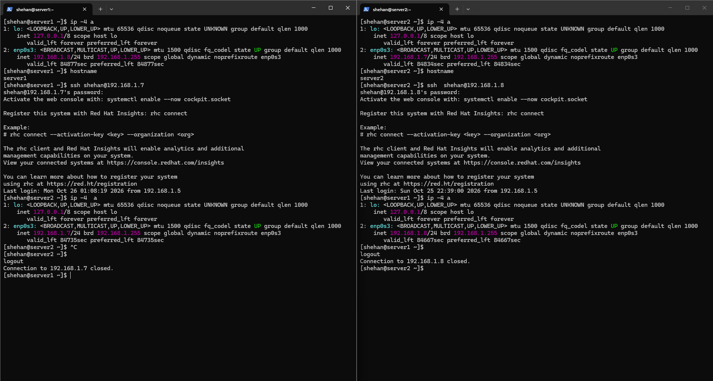
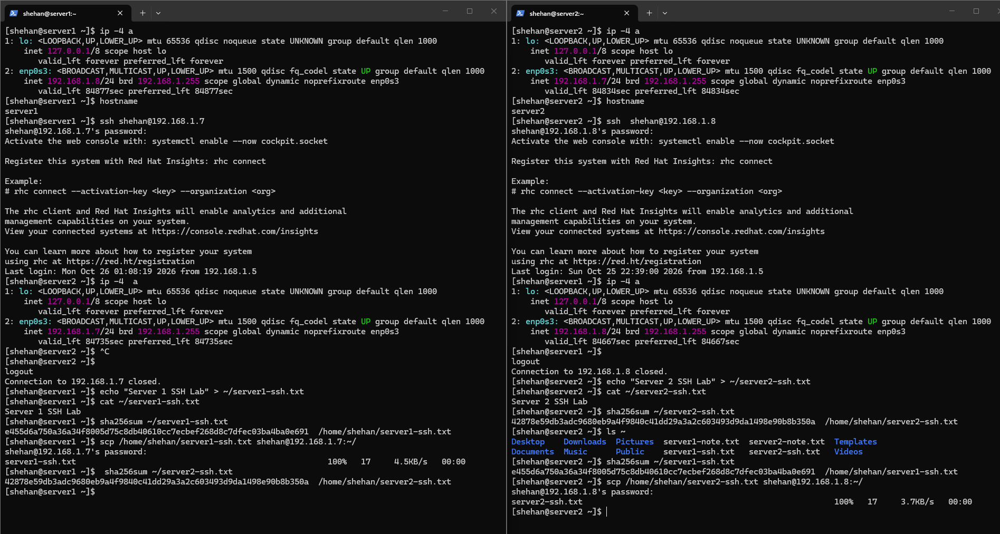
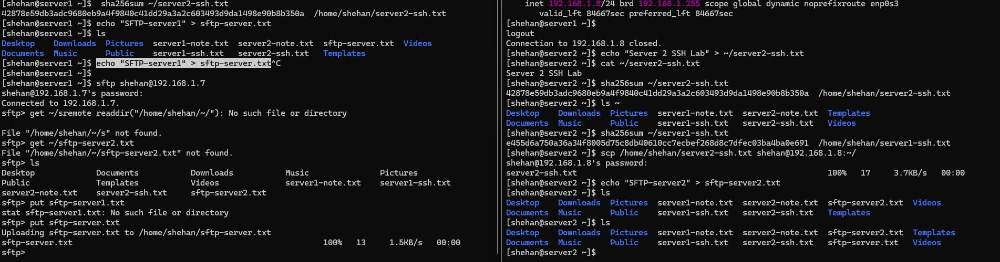

# RHCSA Lab 01 — SSH and Secure File Transfer

## Objective

Connect two RHEL servers using SSH, transfer files in both directions using SCP, verify file integrity using SHA256, and practice SFTP.

## Lab Environment

| System | Hostname | IP Address | User |
|---|---|---|---|
| RHEL VM 1 | server1 | 192.168.1.8 | shehan |
| RHEL VM 2 | server2 | 192.168.1.7 | shehan |

## 1. SSH Connectivity

Connect from server1 to server2:

```bash
ssh shehan@192.168.1.7
hostname
exit
```

Connect from server2 to server1:

```bash
ssh shehan@192.168.1.8
hostname
exit
```

**Result:** Successfully established SSH connections between both RHEL servers.



## 2. SCP File Transfer and SHA256 Verification

### Server1 to Server2

Create a file on server1:

```bash
echo "Server 1 SSH Lab" > ~/server1-ssh.txt
sha256sum ~/server1-ssh.txt
```

Transfer to server2:

```bash
scp ~/server1-ssh.txt shehan@192.168.1.7:~/
```

Verify checksum on server2:

```bash
sha256sum ~/server1-ssh.txt
```

### Server2 to Server1

Create a file on server2:

```bash
echo "Server 2 SSH Lab" > ~/server2-ssh.txt
sha256sum ~/server2-ssh.txt
```

Transfer to server1:

```bash
scp ~/server2-ssh.txt shehan@192.168.1.8:~/
```

Verify checksum on server1:

```bash
sha256sum ~/server2-ssh.txt
```

**Result:** Files were successfully transferred in both directions, and SHA256 checksums matched.



## 3. SFTP File Transfer

Create a test file on server1:

```bash
echo "SFTP-server1" > sftp-server.txt
```

Connect to server2:

```bash
sftp shehan@192.168.1.7
```

Upload the file:

```text
sftp> ls
sftp> put sftp-server.txt
sftp> ls
sftp> bye
```

**Result:** Successfully uploaded the file from server1 to server2 using SFTP.

### Troubleshooting

**Issue:** File not found errors during SFTP operations.

**Cause:** Incorrect file paths and filenames.

**Solution:** Verified the filename using `ls` and successfully uploaded it using `put sftp-server.txt`.

**Note:** Successful SFTP download verification remains pending.



## Key Learnings

- Configured and tested SSH connectivity between two RHEL servers.
- Transferred files using SCP in both directions.
- Verified file integrity using SHA256 checksums.
- Practiced SFTP file upload.
- Troubleshot SFTP file path and filename errors.
- Improved remote Linux system administration skills.

## Lab Status

**Completed:** SSH, SCP, SHA256 Verification, SFTP Upload.

**Pending:** SFTP Download Verification.
