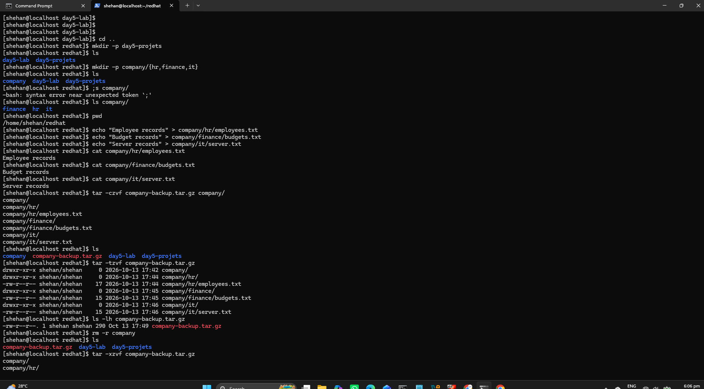
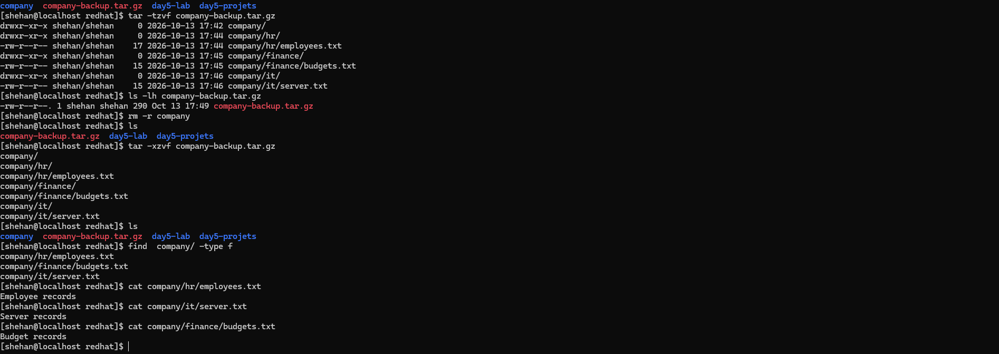

# RHCSA Lab 05 — Links, Archives & Compression

## Overview
This hands-on lab demonstrates essential Red Hat Enterprise Linux file management and backup operations.

## Learning Objectives
- Understand hard links and symbolic links.
- Inspect file metadata and inode information.
- Create and extract tar archives.
- Compress and decompress files.
- Perform backup and recovery operations.
- Verify restored files using SHA256 checksums.

## Technologies
- Red Hat Enterprise Linux
- Bash
- GNU tar
- gzip / gunzip
- bzip2 / bunzip2
- sha256sum

## Lab Scenario
A company needs to protect departmental files through a reliable backup and recovery process.

The task is to create a compressed archive of a simulated company directory, verify the backup, simulate data loss, and restore the files.

## Evidence

## Outcome
To be completed after successful execution and verification of the lab.
