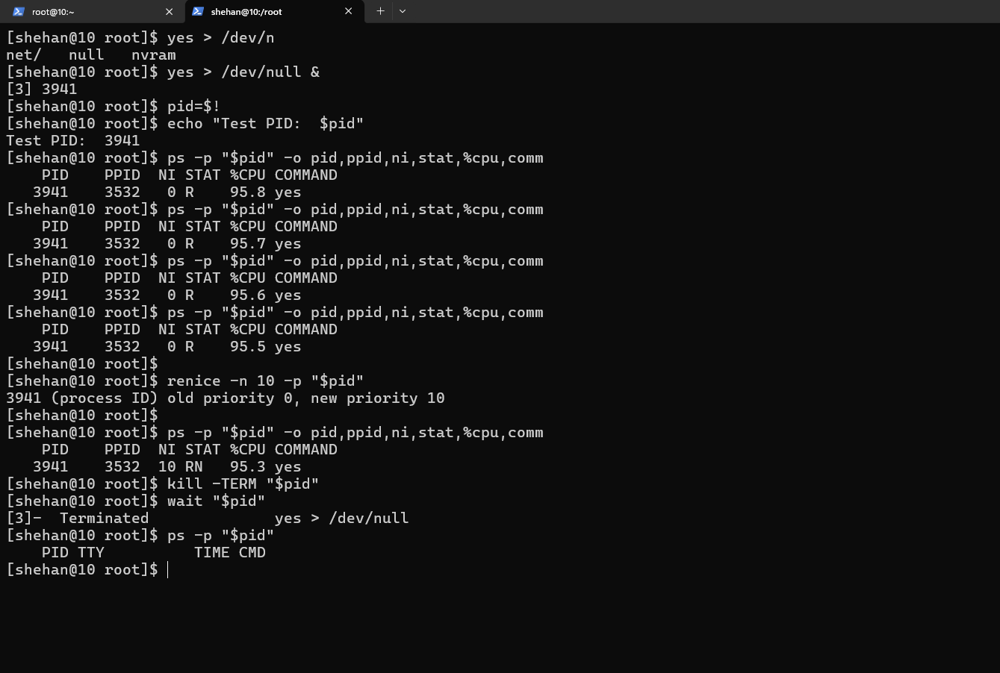

# RHCSA Lab 05 — Linux Process Management

## Objective
Practice monitoring, controlling, prioritizing, and safely terminating Linux processes in Red Hat Enterprise Linux (RHEL).

## Environment
- OS: Red Hat Enterprise Linux
- Shell: Bash
- User: shehan

## Hands-on Practice

### 1. Monitor Processes
```bash
ps aux
ps -ef
top
pgrep -a sshd
```

### 2. Foreground & Background Jobs
```bash
sleep 100 &
jobs
fg %1
```

### 3. CPU Process Management
Start a test process:

```bash
yes > /dev/null &
pid=$!
```

Check CPU usage and priority:

```bash
ps -p "$pid" -o pid,ppid,ni,%cpu,comm
```

Change process priority:

```bash
renice -n 10 -p "$pid"
```

Terminate safely:

```bash
kill -TERM "$pid"
ps -p "$pid"
```

### 4. Background Execution with nohup
```bash
nohup sleep 120 > nohup.log 2>&1 &
```

## Screenshots

### Process Monitoring & Priority Management


## Key Learnings
- Process monitoring using `ps`, `top`, and `pgrep`.
- Foreground and background job management.
- CPU priority control using `nice` and `renice`.
- Safe process termination using signals.
- Background execution using `nohup`.

## Screenshots

### Process Monitoring & Priority Management


