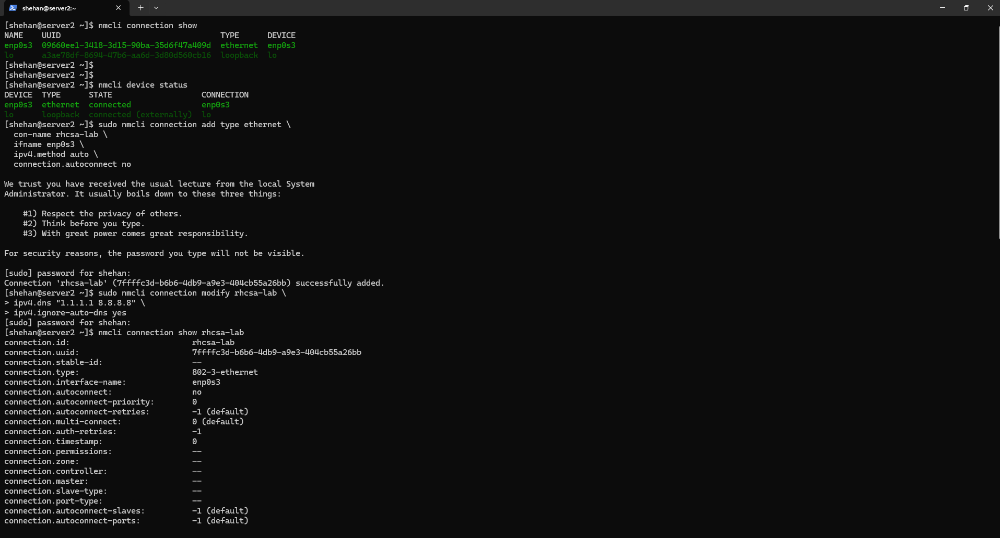
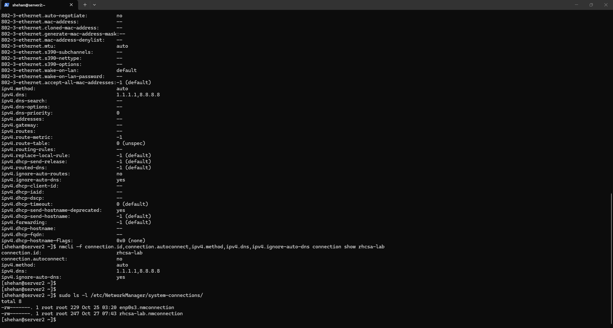

# RHCSA Lab — NetworkManager and TCP/IP

## Objective

Practice basic NetworkManager commands and create a persistent network connection profile using `nmcli`.

## Lab Environment

- OS: Red Hat Enterprise Linux
- User: shehan
- Hostname: server2
- Interface: enp0s3

## Tasks Performed

### 1. Check existing connections

```bash
nmcli connection show
nmcli device status
```

### 2. Create a new connection profile

```bash
sudo nmcli connection add type ethernet \
  con-name rhcsa-lab \
  ifname enp0s3 \
  ipv4.method auto \
  connection.autoconnect no
```

### 3. Modify DNS settings

```bash
sudo nmcli connection modify rhcsa-lab \
  ipv4.dns "1.1.1.1 8.8.8.8" \
  ipv4.ignore-auto-dns yes
```

### 4. Verify the profile

```bash
nmcli -f connection.id,connection.autoconnect,ipv4.method,ipv4.dns,ipv4.ignore-auto-dns connection show rhcsa-lab
```

### 5. Verify persistent profile file

```bash
sudo ls -l /etc/NetworkManager/system-connections/
```

## Result

A new NetworkManager profile named `rhcsa-lab` was created successfully.  
The profile was configured with custom DNS servers `1.1.1.1` and `8.8.8.8`, and `autoconnect` was disabled.

## Screenshots

### Connection creation and modification



### Profile verification and persistent file check



## Key Learnings

- Used `nmcli connection show` to inspect connection profiles.
- Used `nmcli device status` to check device state.
- Created a new Ethernet connection profile.
- Modified DNS settings in a persistent way.
- Verified NetworkManager profile files under `/etc/NetworkManager/system-connections/`.

## Status

**Completed**
