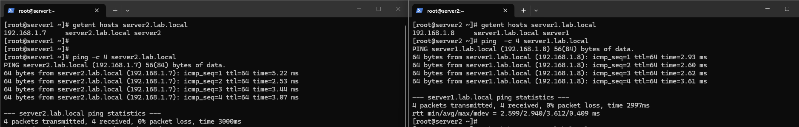
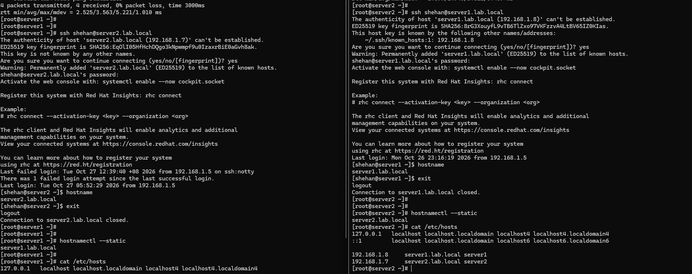

# RHCSA Lab — Hostname and Name Resolution

## Objective
Configure persistent hostnames and enable name resolution between two RHEL servers using `/etc/hosts`.

## Lab Environment

| Server | Hostname | IP Address |
|---|---|---|
| Server 1 | server1.lab.local | 192.168.1.8 |
| Server 2 | server2.lab.local | 192.168.1.7 |

## Tasks Performed

### 1. Configure Hostnames
```bash
sudo hostnamectl set-hostname server1.lab.local
sudo hostnamectl set-hostname server2.lab.local
```

Run the appropriate command on each server.

### 2. Configure `/etc/hosts`

Added the following entries on both servers:

```text
192.168.1.8  server1.lab.local server1
192.168.1.7  server2.lab.local server2
```

### 3. Verify Name Resolution

```bash
getent hosts server1.lab.local
getent hosts server2.lab.local
```

### 4. Test Connectivity

```bash
ping -c 4 server2.lab.local
ping -c 4 server1.lab.local
```

### 5. Test SSH Using Hostnames

```bash
ssh shehan@server2.lab.local
ssh shehan@server1.lab.local
```

## Evidence

### Screenshot 1 — Hostname Configuration and SSH Verification



### Screenshot 2 — Name Resolution and Ping Verification



## Result

- Configured persistent hostnames on both RHEL servers.
- Added hostname-to-IP mappings in `/etc/hosts`.
- Verified mutual name resolution using `getent`.
- Successfully tested connectivity using `ping`.
- Successfully connected to both servers using SSH hostnames.

## Status

**Completed**
